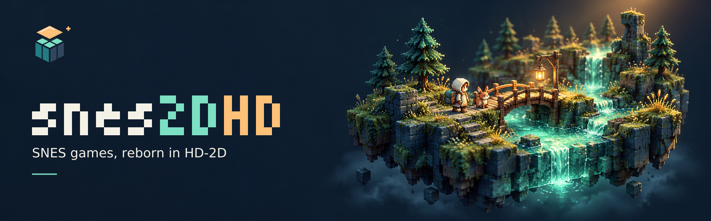
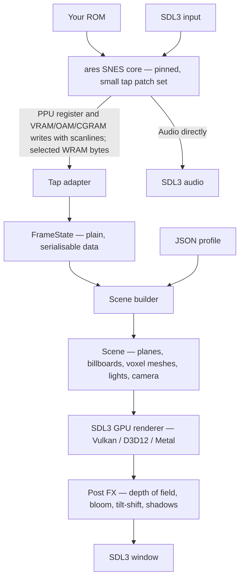

# snes2DHD

An open-source SNES emulator being built to present unmodified games in an HD-2D style.

**Pre-alpha — M0 (repo & agent team). Nothing playable yet.**

The banner is original concept art, not emulator output.

## What HD-2D means here

The planned renderer combines **flat**, Octopath-like pixel sprites and layers in lit 3D scenes with **voxel**, 3dSen-like extruded tiles and sprites. Per-game profiles will choose and mix both styles within a game, tuning geometry, lighting and camera placement. **No profile = stock 2D.**

Our first showcase targets are **Terranigma (PAL/EU)** and **Chrono Trigger (US)** — comparison shots coming in M3.

## Play

Bring your own legally obtained ROM. Starting in **M1**, Linux and Windows builds will be available from the repository's rolling [nightly release](https://github.com/nissifield/snes2DHD/releases/tag/nightly). There are no playable downloads at M0.

When builds arrive, follow the [playtesting guide](./docs/playtesting.md) to compare profile output with stock 2D and report problems.

## Contribute in 2 minutes

Pick a small task card, paste its prompt into your AI tool, and open a PR. Coding agents and browser chats are both welcome: [start here](./CONTRIBUTE.md).

## Planned architecture

Real-game FrameState dumps stay local. Repository test fixtures will use synthetic data only.

## Roadmap

| Milestone | Planned outcome |
| --- | --- |
| M0 — Repo & agent team | Contribution docs, task cards, review and CI setup |
| M1 — It plays | ares core, stock 2D frontend, Linux and Windows nightlies |
| M2 — Flat HD-2D | Planes, billboards, lighting and post effects |
| M3 — Showcase profiles v1 | Terranigma and Chrono Trigger opening areas; comparison shots |
| M4 — Voxel mode | Voxel geometry mixed with flat elements |
| M5 — Profile inspector | In-app profile editing |

See [ROADMAP.md](./ROADMAP.md) for milestone outcomes and [docs/design.md](./docs/design.md) for the full design.

## Licences and credits

Code is **MPL-2.0**; profiles and project-original assets are **CC BY-SA 4.0**. See [NOTICE](./NOTICE) for the licence map and third-party notices.

- **ares — ISC:** the planned SNES emulation core.
- **ponytail — MIT:** the project's minimal-code contribution rules.
- **Inspiration:** 3dSen by Geod Studio and Octopath Traveler's HD-2D look.

snes2DHD is not affiliated with Nintendo, Square Enix or Quintet.
